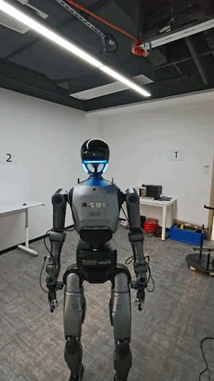
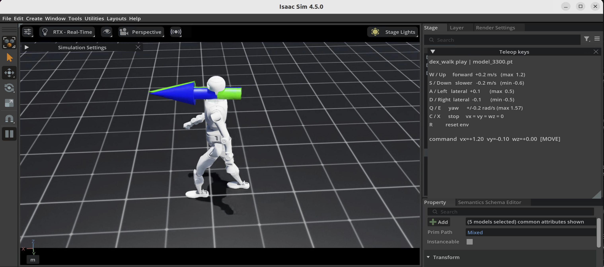
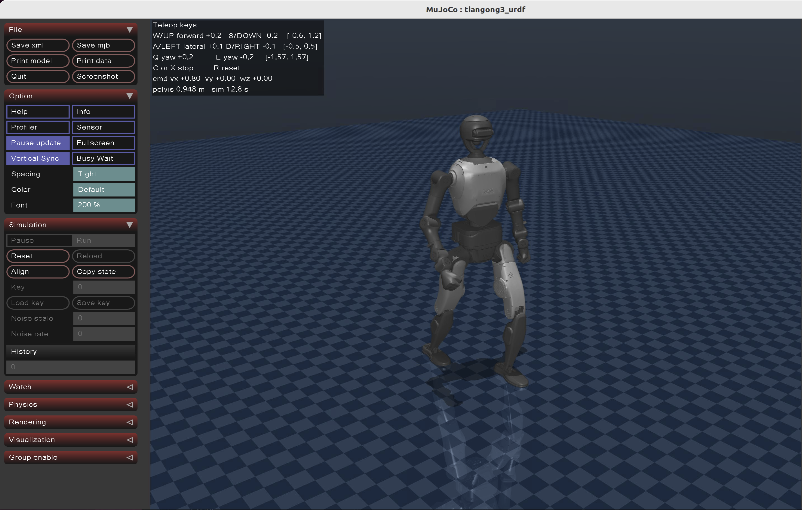
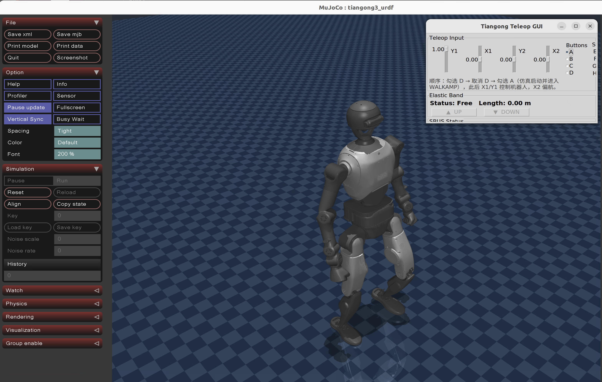
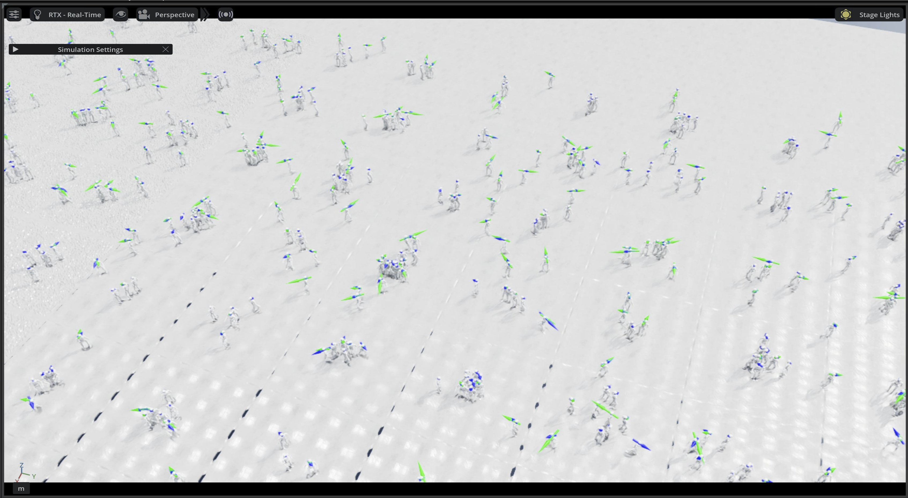

# Dex-RL V4 · 天工行者 Dex 训练与部署栈

**版本**: V4（训练 + Sim2Sim + ROS2 闭环部署）
**更新日期**: 2026-10-29

> **📌 原始版本来源**
>
> 本项目面向天工行者 Dex 双足人形机器人，其**站走一体 RL 训练代码**与**部署代码**的原始版本分别来自以下两个上游分支：
>
> - **站走一体 RL 代码（原始版本）**: <https://github.com/Open-X-Humanoid/TienKung-Lab/tree/dev>
> - **部署代码（原始版本）**: <https://github.com/Open-X-Humanoid/Deploy_Tienkung/tree/3.0>

[](https://docs.omniverse.nvidia.com/isaacsim/latest/overview.html)
[](https://isaac-sim.github.io/IsaacLab)
[](https://github.com/leggedrobotics/rsl_rl)
[](https://docs.ros.org/en/humble/)
[](https://docs.python.org/3/whatsnew/3.10.html)
[](https://releases.ubuntu.com/22.04/)
[](https://opensource.org/licenses/BSD-3-Clause)

---

## 🚀 项目简介

**Dex-RL V4** 是基于 TienKung-Lab 的强化学习**训练 + Sim2Sim + ROS2 闭环部署一体化包**，面向天工行者 Dex（Tienkung_Dex）人形机器人。框架结合 **AMP（Adversarial Motion Priors）** 模仿学习与**周期性步态奖励**，用于训练和评估行走与奔跑策略。

本包提供 Isaac Lab 训练、策略回放与导出、独立 MuJoCo Sim2Sim，以及 ROS2 Humble + MuJoCo 闭环仿真入口。具体验证范围见下方和[包边界](#-包边界)。

> ⚠️ **范围说明：本包以 walk 的 pipeline 为主。**
>
> - **walk**：当前 3300 导出模型及增益（膝 KP 330 / 肩 pitch KD 5）已进行独立 MuJoCo Sim2Sim 和 ROS2 闭环仿真，2026-10-29 结果见[🤖 ROS2 + MuJoCo 闭环](#-ros2--mujoco-闭环)；历史数据仍随包供对照。
> - **run**：包内保留 4096 环境训练的 `model_3500.pt` 和导出策略；尚未对跑步步态质量做验收，包内 run 示例用于检查仿真通路。
> - 若需要 run 的**训练 / 策略回放 / 独立 Sim2Sim** 这三条通路，参照 walk 的流程照做即可（把 `--task=dex_walk` 换成 `--task=dex_run`）。但 **ROS2 闭环与部署侧不接 `--task`**（`scripts/ros_closed_loop.py` 只有 `--duration` / `--policy` / `--band` / `--fault` / `--output`），仍固定加载 `walk_amp` 配置；run 要上闭环需另做部署侧适配。

### ✨ 核心特性

- ✅ **AMP 模仿 + 任务奖励**: 从专家运动数据学习自然步态，`总奖励 = (1-lerp) × coef × max(1-(d-1)²/4, 0) + lerp × 任务奖励`（`d` 为判别器输出，默认 coef=0.3、lerp=0.7）
- ✅ **站走一体**: 支持零速度站立和速度指令控制；运动质量以实际验证结果为准
- ✅ **统一 400/100Hz**: 训练侧物理 `dt=0.0025 / decimation=4`，即物理 400Hz、策略 100Hz
- ✅ **大规模并行**: 默认 4096 环境，已验证 4096 环境无头长训练
- ✅ **独立 MuJoCo Sim2Sim**: 用 MjSpec 删除策略不控制的 6 个关节，复现训练侧 23 关节模型
- ✅ **七状态部署 FSM 随包**: `Deploy_Tienkung/policy/` 六个策略目录提供 `STOP` / `ZERO` / `WALKAMP` / `BEYONDZERO` / `BEYONDMIMIC` / `MIMIC` / `MIMICDEFAULT` 七状态；其中 `WALKAMP`（`walk_amp/model/policy.{pt,onnx}`）、`BEYONDMIMIC`（`niukua/model/*.onnx`）、`MIMIC`（`mimic/out/policy_merged.onnx`）带模型，`STOP` / `ZERO` / `BEYONDZERO` 为保持类实现，不需要策略文件
- ✅ **ROS2 + MuJoCo 闭环**: 四包 colcon 工作区，控制节点与 xSIM 仿真节点经 DDS 闭环，含反馈/推理故障注入下的阻尼停止验收
- ✅ **断点续训 / 权重热启动**: `--resume` 精确续训，`--init_from` 只迁移 actor/critic/std
- ✅ **自包含回归测试**: 训练侧 22 个用例不依赖包外代码

### 🎯 适用场景

| 场景 | 说明 |
| --- | --- |
| **步态训练** | 行走 `dex_walk`、奔跑 `dex_run` |
| **模仿学习研究** | AMP 判别器 + 周期步态奖励的组合 |
| **跨仿真验证** | 同一策略在 Isaac Lab 与独立 MuJoCo 中对比 |
| **部署链路验证** | ROS2 闭环、七状态 FSM 切换、反馈/推理故障的阻尼停止 |
| **教学科研** | 单包自洽，便于复现与二次开发 |

### 🎬 效果预览

[](docs/Dex-Walk.mp4)



---

## 🛠️ 系统要求

| 项目 | 要求 |
| --- | --- |
| **操作系统** | Ubuntu 22.04 LTS |
| **GPU** | NVIDIA RTX 30 系列及以上，显存 16G 及以上。⚠️ 要按**空闲**显存判断：4096 环境实测约 14.5G，而桌面与常驻进程会先占掉 2~3G（16G 卡空闲常只剩 12~13G），此时降到 `--num_envs=2048` 可正常跑，迭代约 13.5 s/次 |
| **内存** | 32GB+（4096 环境实测充足） |
| **磁盘** | 512GB+ SSD |
| **ROS2** | Humble（仅闭环与部署需要；训练与 Sim2Sim 不依赖） |

---

## 📦 环境

本包默认复用**既有**的 Isaac Lab 环境与系统 ROS2，不做安装或版本变更（全新环境的安装路径见下「🆕 全新环境（从零开始）」）。已验证环境：

| 组件 | 版本 |
| --- | --- |
| Python | 3.10.19 |
| IsaacSim / IsaacLab | 4.5.0 / 2.1.0 |
| Torch | 2.5.1+cu124（CUDA 可用） |
| MuJoCo | 3.3.2（Sim2Sim 与闭环） |
| ONNX Runtime | 1.19.2 |
| ROS2 | Humble（`/opt/ros/humble`） |
| colcon | `colcon` / `colcon-bash` / `colcon-argcomplete` |
| pytest | 8.4.2 |
| Conda 环境名 | `env_isaaclab` |

> ⚠️ 版本以 `scripts/ubuntu_env.sh` 激活后的环境为准。**直接调用 `env_isaaclab/bin/python` 会绕过 `activate.d` 钩子**，此时读到的是 conda 环境自带的另一套依赖（torch 2.12 / mujoco 3.9），与本表不符。

`scripts/ubuntu_env.sh` 是**训练侧**统一入口：激活 `env_isaaclab`、关闭用户站点包与字节码、切到包根目录后执行传入命令。它只影响本次进程，不安装依赖、不重绑 editable。

```bash
# 自检
bash scripts/ubuntu_env.sh python -c "import torch, mujoco, onnxruntime; print(torch.__version__, mujoco.__version__)"
```

### 🆕 全新环境（从零开始）

上文是「复用既有环境」的推荐路径。若拿到的是**全新环境**（新机器、新目录，或环境里从未装过本包的本地包），训练侧还有两个本地包必须 editable 安装，否则 `import legged_lab` / `import rsl_rl` 直接失败：

```bash
# 在包根目录执行；解释器需已装好 Isaac Lab，建议套 scripts/ubuntu_env.sh
bash scripts/ubuntu_env.sh python -m pip install --no-deps -e TienKung-Lab          # 分发名 LeggedLab，模块 legged_lab
bash scripts/ubuntu_env.sh python -m pip install --no-deps -e TienKung-Lab/rsl_rl   # 分发名 rsl-rl-lib，模块 rsl_rl
```

> 用 `python -m pip` 而非裸 `pip`：`~/.local/bin/pip` 常排在 conda 环境之前，裸 `pip` 会落到系统 pip 上，可能因缺 `tomli` 直接报 `metadata-generation-failed`。
>
> 用 `--no-deps`：这两步只做**本地绑定**，依赖全部由 Isaac Lab 环境提供，无需 pip 再解析一遍。不加 `--no-deps` 时 pip 会读取 `TienKung-Lab/setup.py` 的 `install_requires`（`IsaacLab`、`pynput`、`mujoco==3.3.2`、`matplotlib`），其中 `IsaacLab` 在 PyPI 上可能匹配到无关同名包而污染环境，或解析失败直接中断安装。`--no-deps` 写在 `-e` 之前或之后均可。

与上游说明一致（见 [`TienKung-Lab/README.md`](TienKung-Lab/README.md) 的 Installation 一节）。装完确认绑定来源指向**本包**而非别处同名目录：

```bash
bash scripts/ubuntu_env.sh python -c \
  "import importlib.util as u; [print(m, u.find_spec(m).origin) for m in ('legged_lab','rsl_rl')]"
```

> ⚠️ **目录改名或搬移后必须重绑。** editable 安装会把**绝对路径**写进环境的 `.pth` 与 finder 文件；此后一旦把包目录改名（例：把带日期后缀的目录名改成 `Dex-RL`）、搬到其它路径或更换用户名，这两个模块就指向已不存在的旧路径，训练入口在导入阶段即失败（实测 `ModuleNotFoundError: No module named 'legged_lab'`）。此时重跑上面两条安装命令即可恢复。
>
> ⚠️ **同机只保留一份被绑定的拷贝。** `import legged_lab` 永远来自最近一次 `pip install -e` 绑定的那份目录。若同机并存多份（例如同机还留着一份旧备份），在**未绑定**的那份里跑训练会静默加载另一份的代码且不报错；按需重绑，或只保留一份。

ROS2 闭环的环境组合不同（需同时激活 conda 与 Humble），**不能**只靠 `ubuntu_env.sh` 启动，见下文「ROS2 + MuJoCo 闭环」。

依赖清单：`requirements-humble.txt`（ROS / 部署侧）与 `Deploy_Tienkung/requirements_22.txt`（部署运行侧）。两者的版本钉扎一致性由 `tests/test_training_entry.py` 中的 `test_ubuntu_deployment_pins_match_the_verified_base_environment` 守护。

---

## 📚 文档资源

| 文档 | 内容 | 说明 |
| --- | --- | --- |
| **[docs/DISCLAIMER.md](docs/DISCLAIMER.md)** | 免责声明 / Disclaimer | **使用前必读** |
| **[docs/ROS_CLOSED_LOOP_GAP.md](docs/ROS_CLOSED_LOOP_GAP.md)** | ROS2 闭环的使用说明与验收结论 | 部署侧交接 |
| **[TienKung-Lab/README.md](TienKung-Lab/README.md)** | 上游训练框架说明 | 训练入口与数据准备 |

---

## 🏗️ 目录结构

| 路径 | 内容 |
| --- | --- |
| `TienKung-Lab/` | Isaac Lab 训练、策略回放、独立 Sim2Sim、训练产物及机器人资产 |
| `Deploy_Tienkung/` | ROS 控制节点、状态机、策略模型与配置 |
| `xSIM_MUJOCO-main/` | ROS MuJoCo 仿真节点及 `dex_v3` 模型 |
| `ros_ws/src/` | ROS 消息包及指向控制、仿真、遥操作包的软链接 |
| `sim_joy/` | 仿真遥操作与 GUI |
| `scripts/` | 环境、训练、后台任务、导出及闭环验证入口 |
| `tests/` | 回归测试 |
| `artifacts/` | 测试基线与仿真报告；运行日志由程序生成 |
| `docs/` | 使用说明、验证记录和免责声明 |

`dex_v3` 模型通过软链接引用 `TienKung_Dex` 网格；移动或打包时需保留链接及其目标。`build/`、`install/`、`log/` 是本机生成的构建产物。

## 🧠 算法原理

### AMP-PPO

```
┌─────────────────┐
│  专家运动数据    │ motion_amp_expert/{walk,run}.txt
└────────┬────────┘
         │ 预载 200000 条转移
         ▼
┌─────────────────────────────────────────────┐
│              AMP-PPO 训练流程                │
│                                             │
│  1. 策略在 4096 环境中收集经验（PPO）         │
│  2. 判别器区分「策略动作」与「专家动作」(AMP)  │
│  3. 总奖励 = (1-lerp)×coef×score + lerp×任务奖励 │
│  4. 同时更新策略、价值函数与判别器            │
└─────────────────────────────────────────────┘
         │
         ▼
┌─────────────────┐
│  自然步态策略    │ → 导出 PT/ONNX → Sim2Sim
└─────────────────┘
```

观测为 **84 维 × 10 帧历史 = 840 维**，动作 **23 维**（`Actor 840→512→256→128→23`，Critic 输入 890）。

---

## ⚙️ 可用任务

| 任务名称 | 说明 | 步态参数 |
| --- | --- | --- |
| `dex_walk` | 站走一体行走 | 步态周期 0.85s，相位偏移 0.38 / 0.88 |
| `dex_run` | 奔跑 | 步态周期 0.64s，相位偏移 0.6 / 0.1 |

两者均在 `legged_lab/envs/__init__.py` 中注册，入口为 `task_registry`（非 gym / hydra），默认 `num_envs=4096`。

> `dex_run` 已进行训练和独立 Sim2Sim 通路测试，步态质量未验收。

```bash
# 行走训练（推荐：用包装器，自动激活环境并进入 TienKung-Lab）
bash scripts/ubuntu_train.sh --task=dex_walk --num_envs=4096 --headless \
    --logger=tensorboard --run_name=my_walk

# 短冒烟：先用 64 环境、2 迭代确认环境与入口
bash scripts/ubuntu_train.sh --task=dex_walk --num_envs=64 --max_iterations=2 --headless \
    --logger=tensorboard --run_name=smoke

# 奔跑训练：从行走检查点热启动（只迁移 actor/critic/std，AMP 判别器从头学）
bash scripts/ubuntu_train.sh --task=dex_run --num_envs=4096 --max_iterations=101 --headless \
    --init_from "$PWD/TienKung-Lab/logs/dex_walk/2026-10-15_19-52-21_v4_walk_4096_20000/model_3300.pt" --run_name=my_run

# 断点续训（与 --init_from 互斥）
bash scripts/ubuntu_train.sh --task=dex_walk --resume=True \
    --load_run=2026-10-15_19-52-21_v4_walk_4096_20000 --checkpoint=model_3300.pt
```

> 📌 包内 `TienKung-Lab/logs/` 已含两组训练产物，可直接用于上面的 `--init_from` / `--resume` 示例。注意**目录名里的迭代数是计划值**，与日志实际记录并不一致：
>
> | run 目录 | 计划迭代 | 日志实记（tfevents 末步） | 保留检查点 |
> | --- | --- | --- | --- |
> | `dex_walk/2026-10-15_19-52-21_v4_walk_4096_20000` | 20000 | **3308**（首步 0，共 3309 条记录） | `model_3300.pt` |
> | `dex_run/2026-10-16_20-57-51_v4_run_4096_20000` | 20000 | **3537**（首步 0，共 3538 条 `Train/mean_reward` 记录） | `model_3500.pt` |

### 训练入口参数

| 参数 | 说明 |
| --- | --- |
| `--task` | `dex_walk` / `dex_run` |
| `--num_envs` | 覆盖 `env_cfg.scene.num_envs`（默认 4096） |
| `--max_iterations` | 覆盖 `agent_cfg.max_iterations`（配置文件默认 50000） |
| `--headless` | 无头模式（训练必选） |
| `--seed` | 固定随机种子，`-1` 为随机 |
| `--init_from` | 热启动：只迁移策略权重；AMP 判别器 / 归一化 / 优化器 / 迭代计数**全部从头** |
| `--resume` / `--load_run` / `--checkpoint` | 精确续训；与 `--init_from` 互斥 |
| `--run_name` / `--experiment_name` / `--logger` | 日志目录与记录器（默认 `tensorboard`） |
| `--distributed` | 多 GPU / 多节点 |

---

## 💾 检查点与命名（**重要**）

保存逻辑在 `rsl_rl/runners/amp_on_policy_runner.py`：

```python
for it in range(start_iter, tot_iter):        # tot_iter = start_iter + num_learning_iterations
    ...
    if it % self.save_interval == 0:
        self.save(os.path.join(self.log_dir, f"model_{it}.pt"))
...
# 循环正常结束后，才写一次最终存档
self.save(os.path.join(self.log_dir, f"model_{self.current_learning_iteration}.pt"))
```

由此得到三条实用结论：

1. **存档名是迭代索引 `it`，不是更新次数。** `it=0` 那一轮已经做完 1 次 PPO 更新才保存，所以 `model_0.pt` = 完成 1 次更新的权重；`model_49999.pt` = 完成 50000 次更新。
2. **`max_iterations=50000` 不会产生 `model_50000.pt`**，最后一个是 `model_49900.pt`（每 `save_interval=100` 一次）加一个最终存档 `model_49999.pt`。想让存档名正好落在整数上，用 `max_iterations = 目标编号 + 1`。
3. **最终存档只在正常跑完时才写。** 中途被中断的长训练，只能靠 `save_interval` 的周期性存档兜底——这也是把 `save_interval` 设小（本包 walk / run 均为 **100**）的意义。

> ⚠️ **上面第 1、2 条的编号推算只适用于「从头训练」**（此时 `start_iter = 0`）。续训时 `start_iter` 会从 checkpoint 里恢复（`amp_on_policy_runner.py` 的 `load()` 中 `self.current_learning_iteration = loaded_dict["iter"]`），而 `num_learning_iterations` 就是本次传入的 `--max_iterations`——所以 **续训时 `--max_iterations` 是「追加迭代数」，不是总迭代数**。例：从 `model_3300.pt` 续训 `--max_iterations=100`，产出的是 `model_3400.pt` 一带的存档，而不是 `model_100.pt`。

| 任务 | `save_interval` | `learning_rate` | 备注 |
| --- | --- | --- | --- |
| `dex_walk` | 100 | 5.0e-4（`adaptive`） | 步态周期 0.85s |
| `dex_run` | 100 | 1.0e-3 | 步态周期 0.64s |

---

## 📐 关键配置

| 项目 | 取值 | 位置 |
| --- | --- | --- |
| 物理步长 | `dt=0.0025`、`decimation=4` → **物理 400Hz / 策略 100Hz** | `envs/dex/{walk,run}_cfg.py` |
| 动作缩放 | `action_scale=0.25` | `envs/dex/walk_cfg.py` |
| 每环境步数 / mini-batch / epoch | `num_steps_per_env=24`、`num_mini_batches=4`、`num_learning_epochs=5` | 两者一致 |
| PPO | `clip_param=0.2`、`gamma=0.99`、`lam=0.95`、`desired_kl=0.01` | 两者一致 |
| AMP | `amp_reward_coef=0.3`、`amp_task_reward_lerp=0.7`、`amp_num_preload_transitions=200000`、判别器 `[1024,512,256]` | 两者一致 |
| 动作标准差下限 | `min_normalized_std=[0.05]*23` | 两者一致 |
| 训练关节数 | **23**（头两轴与 6 个末端轴 fixed） | `urdf/tiangong3_locomotion.urdf` |
| 初始骨盆高度 | **0.995 m** | `assets/Tienkung_Dex/{walk,run}.py` |
| 每脚碰撞圆柱 | **7 个**，Isaac 导入 `replace_cylinders_with_capsules=False` | 本体配置 |
| MuJoCo 部署模型 | `xSIM_MUJOCO-main/resources/dex_v3/urdf/dex_v3.xml`（29 路执行器） | Sim2Sim |

**关于 23 与 29 的差异**：训练本体只驱动 23 个关节；部署侧模型保留 29 路执行器。`sim2sim.py` 启动时用 `MjSpec` 删除策略不控制的 6 个关节（`elbow_yaw` / `wrist_pitch` / `wrist_roll` 左右各 3）及其 `motor_*` 与传感器，使独立 MuJoCo 与训练侧一致，并在日志打印：

```
[sim2sim] locked (not commanded by policy): elbow_yaw_l_joint, wrist_pitch_l_joint, wrist_roll_l_joint, ...
```

---

## 🎮 策略回放（play）

```bash
cd TienKung-Lab
python legged_lab/scripts/play.py --task=dex_walk --num_envs=1 \
    --load_run=2026-10-15_19-52-21_v4_walk_4096_20000 --checkpoint=model_3300.pt
```

- 需要图形显示（默认非 `--headless`）。`play.py` 会同时把策略导出为 `exported/policy.pt` 与 `exported/policy.onnx`，**会覆盖该 run 目录下已有的导出文件**。这两个文件与部署侧 `Deploy_Tienkung/policy/walk_amp/model/` 下的同名文件是**两份独立文件（非软链接）**，play 只覆盖 run 目录里那一份。
- 📌 `play.py` 会改写环境配置：`num_envs` 固定为 **50**（`--num_envs` 可覆盖，示例用 1 只是为看清单个机器人）、回合上限改为 `40s`、关闭观测噪声与域随机、地形强制 `plane`、`height_scanner.drift_range = 0`，并把**随机指令生成器**的范围收紧为 `vx (0, 1) / vy = 0 / wz = 0`。因此 play 里的表现**不等于**训练配置下的表现。
- 📌 别把上面那个"收紧"当成键盘可达范围：`play.py` 是在**收紧之前**就把任务的原始范围捕获下来交给键盘的，所以**键盘实际可达的是任务原始范围**——walk 为 `vx -0.6~1.2`、`vy ±0.5`、`wz ±1.57`；run 为 `vx -0.6~3.0`（`envs/dex/run_cfg.py` 里 `lin_vel_x=(-0.6, 3.0)`）、`vy ±0.5`、`wz ±1.57`。下面按键表里的范围是 **walk** 的口径。
- 回放时命令改用键盘遥操作；`play.py` **没有** `--command` 参数（该参数只存在于 `sim2sim.py`），速度指令只能通过键盘实时给出。
- 📌 `play.py` 主体是 `while simulation_app.is_running()` 的交互循环，且导出动作发生在进入循环**之前**。因此 `--headless` 下脚本不会自行退出，需要用 `Ctrl+C` 结束（否则进程会一直挂住）。

| 按键 | 作用 | 范围 |
| --- | --- | --- |
| `W` / `↑` | 前进加速 +0.2 | 上限 1.2 |
| `S` / `↓` | 前进减速 -0.2 | 下限 -0.6 |
| `A` / `←`、`D` / `→` | 横移 ±0.1 | ±0.5 |
| `Q` / `E` | 偏航 ±0.2 | ±1.57 |
| `C` / `X` | 停止（vx=vy=wz=0） | — |
| `R` | 重置环境 | — |

---

## 🔬 独立 MuJoCo Sim2Sim

默认加载包内配对策略 `Deploy_Tienkung/policy/walk_amp/model/policy.onnx`，也可显式指定任意 **TorchScript** `.pt` 或 `.onnx`（要求输入 840 / 输出 23）。



> ⚠️ `--policy` 只接受**导出产物**：TorchScript `.pt` 或 `.onnx`（`.onnx` 走 onnxruntime，并校验输入 `[1,840]` / 输出 `[1,23]`；其他后缀直接报 `Policy must be a TorchScript .pt or an .onnx file`）。
> `play.py` 导出的 `exported/policy.pt` 是 TorchScript；而训练 checkpoint
> `logs/<task>/<run>/model_N.pt` 是含 `model_state_dict` / `optimizer_state_dict` 的字典，**不能直接用**，
> 否则 `torch.jit.load` 会报 `PytorchStreamReader failed locating file constants.pkl`。要先用 `play.py` 导出。

```bash
# 行走：恒定 0.4 m/s，30 秒，带 MuJoCo 视窗与键盘遥操作
python TienKung-Lab/legged_lab/scripts/sim2sim.py --task dex_walk \
    --policy Deploy_Tienkung/policy/walk_amp/model/policy.onnx --duration 30 --command 0.4 0 0 \
    --output artifacts/my_walk.json

# 无头批量验证
python TienKung-Lab/legged_lab/scripts/sim2sim.py --task dex_walk --headless \
    --duration 10 --command 0.8 0 0 --output artifacts/my_walk_headless.json

# 奔跑：必须显式提供与之匹配的 run 策略，不能用 walk 策略代替。
# 包内已含一份导出的 run TorchScript，可直接用
# （该 run 策略用于检查仿真通路，不代表跑步步态已验收）：
python TienKung-Lab/legged_lab/scripts/sim2sim.py --task dex_run --headless \
    --policy TienKung-Lab/logs/dex_run/2026-10-16_20-57-51_v4_run_4096_20000/exported/policy.pt \
    --duration 10 --command 1.0 0 0
```

| 参数 | 说明 |
| --- | --- |
| `--task` | `dex_walk` / `dex_run`（run 会额外从 `assets/Tienkung_Dex/run.py` 读取初始姿态与 PD 增益，并切换步态周期 0.64s / 相位 0.6,0.1） |
| `--policy` | **导出产物**：TorchScript `.pt` 或 `.onnx`；walk 缺省用包内配对 ONNX。训练 checkpoint 不可直接用 |
| `--model` | 缺省 `xSIM_MUJOCO-main/resources/dex_v3/urdf/dex_v3.xml` |
| `--duration` / `--command` | 仿真时长（秒）/ 恒定速度指令 `vx vy wz` |
| `--sequence stand_walk_stop` | 站—走—站序列，中间段仍为 0.4 m/s |
| `--headless` / `--no-teleop` | 关闭视窗 / 关闭键盘窗口 |
| `--output` | 写出 JSON 报告 |

报告字段：`steps`、`simulation_seconds`、`min_pelvis_height`、`final_position`、`finite`、`collapsed`（`min_pelvis_height < 0.5` 判定）；`collapsed` 或数值非有限时进程以退出码 1 结束。

> 视窗关闭可能使仿真提前结束，退出码仍可能为 0。请同时检查 `simulation_seconds` 是否接近请求时长；不需要视窗时使用 `--headless`。

> 📌 判定口径：`min_pelvis_height` 只说明未倒地，**不等于速度跟踪合格**。低速（0.4 m/s）跟踪偏弱是当前已知边界。

---

## 🤖 ROS2 + MuJoCo 闭环

本包内含完整的 ROS2 部署栈，可在**无真机**条件下把「控制节点 ↔ xSIM 仿真节点」经 DDS 跑通并验收。



四个包：

| 包名 | 构建类型 | 内容 |
| --- | --- | --- |
| `rl_control` | ament_python | 部署侧 `Deploy_Tienkung`，含 `rl_control_node.py` 与七状态 FSM |
| `mujoco_node` | ament_python | xSIM 仿真节点 `xSIM_MUJOCO-main` |
| `sim_joy` | ament_python | 手柄遥操作与 GUI 监视 |
| `bodyctrl_msgs` | ament_cmake | 自定义消息 / 服务 |

`ros_ws/src/` 中除 `bodyctrl_msgs`（实体目录）外的三个都是指向包根同名目录的**软链接**，与训练侧复用同一份核心代码。

### 构建

工作目录为包根；`build` / `install` / `log` 落在包根下：

```bash
source /opt/ros/humble/setup.bash
colcon build --base-paths ros_ws/src \
    --packages-select bodyctrl_msgs rl_control mujoco_node sim_joy \
    --symlink-install \
    --cmake-args -DPYTHON_EXECUTABLE=/usr/bin/python3 -DPython3_EXECUTABLE=/usr/bin/python3
```

首次构建的主要耗时在 `bodyctrl_msgs` 的消息代码生成上。之后每次使用都需要：

```bash
source /opt/ros/humble/setup.bash
source install/setup.bash
```

### 闭环验收

`scripts/ros_closed_loop.py` 把仿真节点与控制节点放在**同一进程**内、经 localhost DDS 通信，按
「等四组实时新鲜样本就绪 → `ZERO` → `WALKAMP`」的顺序推进，运行中可注入故障。

> 📌 该脚本内部固定 `headless=True`，**没有任何 MuJoCo 窗口**，产出的是 JSON 报告——想看界面要走下面的「启动仿真栈」。

环境需要**同时**具备 conda 与 Humble，故不能用 `ubuntu_env.sh` 代劳：

```bash
source ~/miniconda3/etc/profile.d/conda.sh && conda activate env_isaaclab
source /opt/ros/humble/setup.bash
source install/setup.bash
python scripts/ros_closed_loop.py --duration 15 \
    --output artifacts/ros_closed_loop.json
```

| 参数 | 说明 |
| --- | --- |
| `--duration` | 仿真时长（秒），默认 12 |
| `--policy` | 显式候选 ONNX；不覆盖默认模型 |
| `--band` | 带外部支撑的**仅传输**测试，不是步态验收 |
| `--fault feedback` / `--fault inference` | 注入一处故障，验证仅阻尼停止（须收到 `kp=0` / `kd=1`） |
| `--output` | 报告 JSON 路径，默认 `artifacts/ros_closed_loop.json` |

判据（写入 JSON，并反映到进程退出码）：

- **常规**：`validation_error` / `controller_error` / `simulator_error` / `collapsed` 任一非空，或状态序列中不含 `WALKAMP` → 退出码 1
- **故障**：须同时满足「无 `validation_error`」且「有 `controller_error`」且「`damping_stop_received` 为真」

当前配置验收（2026-10-29；包内 3300 导出 ONNX，膝 KP 330 / 肩 pitch KD 5，即 `walk_amp.yaml` 现值）：

| 用例 | 退出码 | 仿真秒 | 最低骨盆 | 前向位移 | 关键字段 |
| --- | --- | --- | --- | --- | --- |
| 无支撑 `--duration 15` | **0** | 15.0025 | 0.95294 | 0.1612 m | `states=[WALKAMP,ZERO]`、`collapsed=false`、29 路命令 |

> 原始报告：`artifacts/ros_closed_loop_gain330_20261029.json`，表中数值取自其 `min_pelvis_height` / `forward_displacement`；`controller_error` / `validation_error` / `simulator_error` 均为 `null`，启动期四组反馈新鲜度约 0.0034 秒。同增益下的独立 Sim2Sim（0.8 m/s、10 s）前向 7.63 m、最低骨盆 0.9640，见 `artifacts/walk08_gain330_20261029.json`。

历史闭环及故障注入记录使用修改前的增益，见 [ROS 闭环说明](docs/ROS_CLOSED_LOOP_GAP.md)。这些结果用于历史对照，不代表当前配置的全部工况已经重新验证。

闭环通过未倒地和状态切换判据不等于速度跟踪合格；低速跟踪仍需进一步验证。

### 把闭环切到某个 checkpoint 的策略

仓库默认配置加载 `Deploy_Tienkung/policy/walk_amp/model/policy.onnx`；实际加载路径以运行环境的 `walk_amp.yaml` 为准。切换模型前须确认 ONNX 对应的 checkpoint 和训练配置，再核对并按需更新步行增益；仅修改路径不会自动同步增益。模型路径在 `Deploy_Tienkung/policy/walk_amp/config/walk_amp.yaml`：

```yaml
# 默认：相对 policy/walk_amp/model/ 目录
model_path: policy.onnx
# 指向任意导出产物：解析用的是 os.path.join(current_dir, "model", model_path)，
# 因此填绝对路径会被直接采用，无需替换包内模型文件
model_path: /abs/path/TienKung-Lab/logs/dex_walk/<run>/exported/policy.onnx
```

- 该字段由 `policy/walk_amp/fsm_walkamp.py` 读取；生效后日志会出现 `[FSMStateWALKAMP-ONNX] ONNX model loaded successfully: ...`。实测填入 3300 的导出 ONNX 后，FSM 正常 `STOP → ZERO → WALKAMP`（见上表）。
- ⚠️ `walk_amp.yaml` 是**共享配置**：`sim2sim.py` 也读它来取 `joint_names` / `gains` / `init_state` / `dt`。改 `model_path` 只影响 ROS 侧选哪个策略，但改其它字段会**同时**影响 Sim2Sim 与部署侧。
- 只想临时验证、又不想动包内文件：直接用闭环脚本的 `--policy`（仅改内存路径），不需要改 yaml。

### 步行模型部署时的 KP/KD 和脚踝转换

1. 确认要部署的 ONNX 由哪个 checkpoint 导出，并找到该次训练目录的 `params/env.yaml`。不要仅凭文件名推断模型与训练记录的对应关系。
2. 在训练快照的 `scene.robot.actuators` 中读取各关节的 `stiffness`（KP）和 `damping`（KD），按 `walk_amp.yaml` 的 `joint_names` 逐项填写 `gains.kp` / `gains.kd`。训练快照使用关节名称匹配表达式；左右关节都要核对。步行 FSM 从此 YAML 读取增益，不会从 checkpoint、ONNX 或训练快照自动同步。
3. 本包当前步行增益与 `dex_walk/2026-10-15_19-52-21_v4_walk_4096_20000/params/env.yaml` 对齐：左右膝 pitch KP 为 **330**，左右肩 pitch KD 为 **5**；左右脚踝 pitch 为 **30 / 2.5**，roll 为 **16.8 / 1.4**（KP / KD）。包内 `policy.onnx` / `policy.pt` 与该 run 的 `exported/` 下同名文件逐字节一致（ONNX sha256 `d37942c2…`），即模型与增益同源；基线记录见 `tests/fixtures/duan_baseline.json`。
4. 脚踝填写的是策略所用的串联关节空间增益。真机 `sim=false` 时，`common/robot_interface.py` 使用 `sptlib_python` 将并联电机反馈转换到串联关节空间；下发前用当前策略增益计算关节力矩，再转换为并联命令，保留当前策略增益，沿用部署代码的处理方式。不要用 `dex_config_real.yaml` 中的全局 `ankle_kp_p` / `ankle_kd_p` 替换这条转换路径中的策略增益。仿真模式不运行此真机转换。
5. 确认实际运行环境加载的是更新后的模型和配置：源码运行读取策略模块旁的 YAML；ROS 安装运行须核对安装环境实际加载的文件，必要时重新构建并核验。不要把 `--policy` 临时切换模型理解为同步了增益。

本次步行增益对齐会同时改变 walk 的独立 Sim2Sim 和 ROS 闭环使用的增益；`dex_run` 的独立 Sim2Sim 会另从 `run.py` 覆盖增益。仿真侧已按当前模型与增益复验（2026-10-29 闭环与 `artifacts/walk08_gain330_20261029.json`），上面的历史数据仅作对照；真机脚踝的串联/并联转换不在本次复验覆盖范围内。run 的 ROS 部署仍需另行适配。

### 启动仿真栈

方式一，直接用 launch（**三个入口只需选一个**，整栈已经包含 MuJoCo 与 GUI）：

```bash
source /opt/ros/humble/setup.bash && source install/setup.bash
# 整栈：MuJoCo 仿真 + sim_joy GUI + 控制节点（真机栈用 real.launch.py）
ros2 launch rl_control sim.launch.py
# 下面两条只在「单独启动某个组件」时使用，与 sim.launch.py 同时跑会重复启动
ros2 launch mujoco_node mujoco_sim.launch.py    # 只起 MuJoCo 仿真节点
ros2 launch sim_joy teleop_joy.launch.py        # 只起手柄遥操作（Tk GUI 版是 teleop_gui.launch.py）
```

方式二，用包装脚本（**首次必须先跑 `init_env.sh`**；`run_sim.sh` 检测不到 `.venv` 会直接报错退出，它自己只做 `colcon build` → `source install` → `ros2 launch`）：

```bash
./init_env.sh     # 首次：创建 .venv，安装 requirements-humble.txt / requirements_22.txt
./run_sim.sh      # 仿真栈；真机栈用 ./run_real.sh
```

> `.venv` 路线与上文「系统 Humble + `env_isaaclab`」是两套独立环境，按需选一套即可。
>
> - **走系统 Humble + conda 路线**：节点由系统 `python3` 执行，需把 conda 站点包注入 `PYTHONPATH`：
>   `export PYTHONPATH="$CONDA_PREFIX/lib/python3.10/site-packages:$PYTHONPATH"`。
> - **`ROS_DOMAIN_ID` 必须一致**：`run_sim.sh` 默认 `42`；`ros_closed_loop.py` 用 `os.environ.setdefault('ROS_DOMAIN_ID', '137')` 且设 `ROS_LOCALHOST_ONLY=1`，即外层已设时跟随外层。两条路线的域号不一致会互相看不见话题。
> - ⚠️ **关窗口会把整栈带走**：关 MuJoCo 窗口 → viewer 线程退出 → 仿真与控制随之停止，控制节点以 `imu sensor sample is older than 0.5 s` 触发阻尼停止；关 Tk 窗口 → `teleop_gui` 正常退出。长跑请用 `nohup` 或 tmux，避免误判成启动失败。
> - 需要无界面等价验收时用 `scripts/ros_closed_loop.py`；只要数值、不要视窗时给 `sim2sim.py` 加 `--headless`。
>
> 📌 ROS 侧的完整使用说明与验收数据见 [docs/ROS_CLOSED_LOOP_GAP.md](docs/ROS_CLOSED_LOOP_GAP.md)。

---

## 📈 监控训练

```bash
tensorboard --logdir=TienKung-Lab/logs
```

访问 `http://localhost:6006`。核心观察指标：

| 指标 | 说明 | 期望 |
| --- | --- | --- |
| `Episode_Reward/track_lin_vel_xy_exp` | 线速度跟踪 | 随迭代上升 |
| `Episode_Reward/track_ang_vel_z_exp` | 角速度跟踪 | 随迭代上升 |
| `Train/mean_episode_length` | 回合长度 | 上升并稳定 |
| `Loss/*` | 策略/价值/判别器损失 | 不出现持续发散 |



也可用包内分析器（`legged_lab/scripts/...` 是相对路径，**需先进入 `TienKung-Lab`**）：

```bash
cd TienKung-Lab
python legged_lab/scripts/analyze_training_log.py --task dex_walk   # 可选 --window / --groups / --watch
```

### 多 GPU 训练

```bash
cd TienKung-Lab        # 训练入口要求以 TienKung-Lab 为工作目录（AMP 数据路径依赖它）
torchrun --standalone --nnodes=1 --nproc_per_node=2 \
    legged_lab/scripts/train.py --task=dex_run --logger=tensorboard \
    --num_envs=1024 --headless --distributed
```

---

## 🖥️ 后台任务

长时间训练建议用包内后台任务入口，SSH 断开后任务继续，并保留命令、PID、日志和**真实退出码**：

```bash
python3 scripts/ubuntu_job.py my_walk_4096 bash scripts/ubuntu_train.sh \
    --task=dex_walk --num_envs=4096 --headless --run_name=my_walk
```

产物在 `artifacts/remote_runs/<job_id>/`：`job.json`（完整命令）、`pid.txt`、`output.log`、`result.json`（`returncode` 为实际退出码）。**没有 `result.json` 时不要当作成功**，需结合 PID 判断。

> ⚠️ 在终端窗口里**前台**跑（包括直接调用 `ubuntu_train.sh`）不算后台任务：窗口一关、进程随之消失，既不会写 `result.json`，**也不会写最终存档**（只剩 `save_interval` 的周期存档），事后无法判定是正常结束还是被中断。长训练一律用本节的 `ubuntu_job.py`。

---

## ✅ 回归测试

含 ROS 侧用例（`bodyctrl_msgs`）的文件需先 source install：

```bash
source /opt/ros/humble/setup.bash && source install/setup.bash
python -m pytest tests -q -p no:cacheprovider     # 91 passed
```

覆盖范围（14 个文件）：

- **训练侧**：`test_training_entry.py`（入口 CLI / 退出码 / 依赖钉扎）、`test_dex_assets.py`（本体资产与任务注册）、`test_rewards_compat.py`（奖励新旧 API 兼容）、`test_observations.py`（独立 MuJoCo 与部署观测逐帧一致）
- **ROS / 部署侧**：`test_ros_closed_loop.py`、`test_ros_lifecycle.py`、`test_ros_packaging.py`、`test_pd_hold.py`、`test_simulator_timing.py`、`test_mimic_debug_timing.py`、`test_entry_consistency.py`、`test_regressions.py`
- **工具链**：`test_export_default.py`（策略导出默认值）、`test_ubuntu_jobs.py`（后台任务入口）

> 当前共 **91 项、0 失败**。

---

## 📦 包边界

本包包含训练、Sim2Sim 和 ROS2 闭环仿真入口。以下内容不在包内：

- **非 ROS 的 MuJoCo 备选资产**：`Tienkung_Dex/mujoco/` 下的 `meshes_convex/`、`meshes_simplify/`、`tiangong3_torq.xml`、`tiangong3_simplify.xml`，以及模型生成脚本。`scripts/sync_dex.py` 不依赖这些备选资产，但依赖包内 `meshes_import/` 的腰部上下两块 OBJ。运行时会覆盖两份派生 URDF、`dex_config.yaml`、转换生成的 OBJ 和正式闭环模型 `dex_v3.xml`；请先保留本地修改，运行后检查 `git diff`。
- **历史样机模型**：`xSIM_MUJOCO-main/resources/` 只保留闭环使用的 `dex_v3`（`simulator_view_asyn.py` 的模型注册表同此）。
- **依赖上述资产的测试**：仅与这些资产相关的用例未随包提供。

如需完整资产，请使用对应的完整发布包。

---

## 📄 许可证

各组件适用其各自的许可文件：[`TienKung-Lab/LICENSE`](TienKung-Lab/LICENSE)、[`Deploy_Tienkung/LICENSE.txt`](Deploy_Tienkung/LICENSE.txt)、[`xSIM_MUJOCO-main/LICENSE`](xSIM_MUJOCO-main/LICENSE)。本体资产的许可说明见 [资产 README](TienKung-Lab/legged_lab/assets/Tienkung_Dex/README.md#许可证)；其他组件请核对其各自的许可声明。

---

## ⚠️ 免责声明

**使用本软件前请务必阅读 [docs/DISCLAIMER.md](docs/DISCLAIMER.md)**。人形机器人属于高风险机电设备，训练、仿真与部署均存在机械伤害、数据安全与算法可靠性风险；本软件按「现状」提供，不附带任何明示或暗示的保证。

---

## 📌 引用

```bibtex
@software{tienkung_lab_2026,
  title={TienKung-Lab: Reinforcement Learning Framework for Humanoid Robots},
  author={Open-X-Humanoid Team},
  year={2026},
  url={https://github.com/Open-X-Humanoid/TienKung-Lab}
}
```

---
